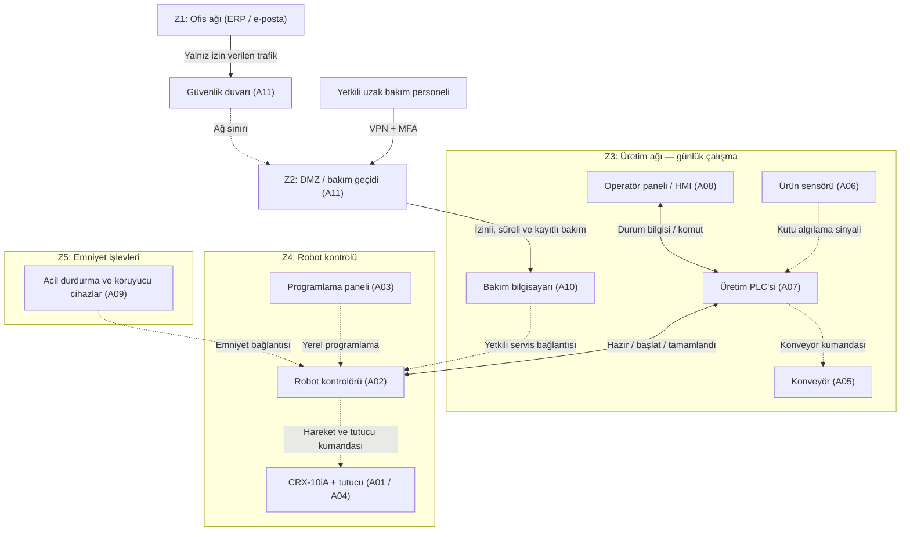

# 02 — Network Architecture (Ağ Mimarisi)

**Makine:** FANUC CRX-10iA  
**Senaryo:** Konveyörden kutuları alıp palete yerleştiren varsayımsal robot hücresi.  
**Çalışma türü:** Kör analiz. Bu çizim gerçek bir FANUC tesisine ait değildir.

## Amaç

Bu bölümde hücrenin **normal üretim haberleşmesini**, **ofis ağıyla olan sınırını**, **uzaktan bakım yolunu** ve **emniyet bağlantılarını** birlikte ele aldım. Kullanılan A01–A11 kodları `01-Asset-Inventory` dosyasındaki varlıklardır.

## Örnek ağ ve kontrol şeması

**Şemayı okuma:** Robotun çalışması için **VPN veya DMZ gerekmez**; bunlar sadece izin verilen bakım bağlantısında kullanılır. Kesikli çizgiler saha sinyalini, kontrol veya emniyet bağlantısını da temsil edebilir. **Şemadaki her ok Ethernet/IP ağı değildir.** Z1–Z5 adları daha sonra `05-Zone-Conduit` bölümünde ayrıntılandırılacak mantıksal bölgelerdir.

## 1. Normal üretim nasıl işler?

1. Konveyör kutuyu robotun alma noktasına taşır; ürün sensörü kutunun geldiğini PLC'ye bildirir.
2. Üretim PLC'si, robot kontrolörüyle **hazır / başlat / tamamlandı** gibi temel durum ve komut bilgilerini paylaşır.
3. Robot kontrolörü, robot kolunu ve tutucuyu yöneterek kutuyu palete yerleştirir.
4. Operatör HMI üzerinden çalışmayı izler; izin verilen başlatma, durdurma ve durum görüntüleme işlemlerini yapar.

Bu akışta PLC ile robot kontrolörü arasındaki **haberleşme arayüzü varsayılmıştır**; kullanılan gerçek protokol bilinmemektedir. Robot kolunun kontrolöre bağlı olması, kolun ayrı bir ofis ağı cihazı olduğu anlamına gelmez.

## 2. Ofis ağı ve bakım bağlantısı

Ofis ağı (Z1), üretim kontrolünden ayrılmalıdır. İnternet veya ofis bilgisayarından robot kontrolörüne doğrudan erişim öngörmüyoruz. Yetkili servis gerektiğinde **VPN + MFA → DMZ / jump server → bakım bilgisayarı → robot kontrolörü** yolunu kullanabilir. Erişim süreli ve kayıtlı olmalıdır; bağlantı sürekli açık tutulmamalıdır. Bu **önerilen tasarımdır**, mevcut FANUC kurulumu hakkında doğrulanmış bilgi değildir.

## 3. Emniyet bağlantısı

Acil durdurma veya koruyucu cihaz devreye girdiğinde tehlikeli robot hareketinin güvenli şekilde durması hedeflenir. Bu yol, normal üretim komutlarından ve uzaktan bakım oturumundan bağımsız korunmalıdır. **Ayrı bir Safety PLC bulunduğu varsayılmamıştır**; emniyetin robot kontrolöründeki güvenli işlevlerle mi yoksa ek donanımla mı sağlandığı gerçek kurulum için bilinmiyor.

## Bağlantı özeti

| Kaynak → Hedef | Haberleşme / görev | Bağlantı türü |
|---|---|---|
| Ürün sensörü → PLC | Kutunun algılandığını bildirir. | Saha sinyali (varsayım) |
| HMI ↔ PLC | Operatör komutu ve üretim durumu. | Üretim haberleşmesi |
| PLC ↔ Robot kontrolörü | Hazır / başlat / tamamlandı bilgisi. | Üretim haberleşmesi (protokol bilinmiyor) |
| Robot kontrolörü → robot kolu / tutucu | Fiziksel hareketi yönetir. | Robot kontrol bağlantısı |
| Servis → VPN/DMZ → bakım PC → kontrolör | Yetkili, süreli uzaktan bakım. | Bakım erişimi (önerilen) |
| Koruyucu cihazlar → emniyet kontrol işlevi | Güvenli duruşu tetikler. | Emniyet bağlantısı (ayrıntı bilinmiyor) |

## Kısa değerlendirme

Günlük üretimdeki PLC–HMI–robot haberleşmesi bakım ağından ayrılmalıdır. Ofis ağından kontrolöre doğrudan erişim olmamalı ve emniyet durdurması sıradan ağ komutlarına bağımlı kalmamalıdır. Gerçek IP adresleri, portlar, saha protokolleri ve kurulu ağ cihazları **bilinmiyor**; bunlar tespit edilmiş bulgu olarak sunulmuyor.

**Devamı:** Ağ geçişlerinin güvenlik kuralları `05-Zone-Conduit`; bakım oturumunun ayrıntıları `06-Remote-Access-Procedure`; emniyet fonksiyonları `03-Safety-Functions` başlığında incelenecektir.

**Ders dayanağı:** `Sunum.pdf` ve `2.1. lab_foyleri_genel.pdf` içindeki LAB 1–2 başlıkları.
