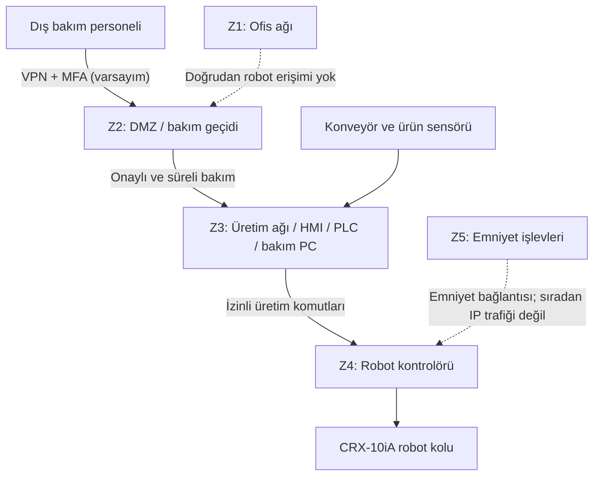

# 02 — Network Architecture (Ağ Mimarisi)

**Makine:** FANUC CRX-10iA  
**Senaryo:** Kutuları konveyörden alıp palete yerleştiren robot hücresi.  
**Durum:** Kör analiz / varsayımsal ağ tasarımı.

## Amaç

Bu bölümde, **01 – Asset Inventory** dosyasındaki cihazların birbiriyle nasıl haberleşebileceğini gösteriyorum. Aşağıdaki çizim FANUC'un gerçek fabrika ağı değildir; ders için oluşturulmuş örnek bir mimaridir.

## Örnek ağ şeması

## Temel bağlantılar

| Kaynak → Hedef | Amaç | Önerilen sınır |
|---|---|---|
| Konveyör / sensör → Üretim PLC'si (A05–A07) | Kutu geldiğinde üretim sırasını başlatmak | Yalnız gerekli sinyaller |
| Üretim PLC'si / HMI → Robot kontrolörü (A07–A08 → A02) | Robotun çalışma sırasını yönetmek | Yetkili komutlar |
| Bakım personeli → DMZ → Bakım PC (A10–A11) | Gerektiğinde uzaktan bakım yapmak | VPN, MFA, süreli izin ve kayıt |
| Emniyet işlevleri (A09) → Robot kontrolü | Tehlikeli hareketi güvenli biçimde durdurmak | Normal ağ komutlarından bağımsız koruma |

## Kısa değerlendirme

Ofis ağı, üretim ağı ve robot kontrolü aynı erişim yetkilerine sahip olmamalıdır. Bakım bağlantısı sürekli açık tutulmamalı; emniyet işlevleri de sıradan ağ trafiğine bağımlı olmamalıdır.

**Bilinen sınırlar:** Gerçek IP adresleri, ağ protokolleri, VLAN yapısı ve uzaktan erişim kullanılıp kullanılmadığı bilinmiyor. Ayrıntılı bölge/geçiş kuralları **05 – Zone & Conduit**, uzaktan erişim kararları **06 – Remote Access Procedure** başlığında ele alınacaktır.

**Dayanak:** Dersin *Sunum.pdf* ve *2.1. lab_foyleri_genel.pdf* LAB 2 bölümleri; bu projedeki *01 – Asset Inventory* ve *LAB 2* taslakları.
