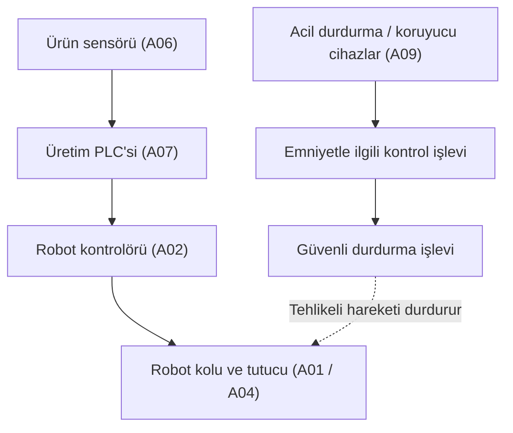

# 03 — Safety Functions (Emniyet Fonksiyonları)

**Makine:** FANUC CRX-10iA  
**Senaryo:** Konveyörden kutuları alıp palete yerleştiren varsayımsal robot hücresi.  
**Kapsam:** Kör analiz; gerçek bir fabrikanın doğrulanmış emniyet tasarımı değildir.

## Amaç

Bu bölümde robotun çalışana zarar vermesini önlemek için **hangi emniyet fonksiyonlarına ihtiyaç duyulduğunu** ve tehlike anında sistemin nasıl davranması gerektiğini inceliyorum. `01-Asset-Inventory` dosyasındaki **A01 (robot), A02 (kontrolör), A04 (tutucu) ve A09 (emniyet işlevleri)** esas alınmıştır.

## Tehlikeler ve emniyet fonksiyonları

| Olası tehlike | Gerekli koruma / emniyet fonksiyonu | Beklenen güvenli durum |
|---|---|---|
| Robot kolunun çalışana çarpması | **SF-01:** Acil durdurma talebinde tehlikeli hareketi güvenli durdurma | Robotun tehlikeli hareketi durur. |
| Çalışanın robotun hareket alanına girmesi, sıkışması | **SF-02:** Koruyucu cihaz tetiklenince koruyucu duruş | Tehlikeli hareket, insan korunacak şekilde durdurulur. |
| Durma sonrasında robotun beklenmedik şekilde yeniden çalışması | **SF-03:** Güvenli yeniden başlatma koşulu | Sadece tehlike giderilip gerekli onay verildikten sonra çalışır. |
| Tutucudaki kutunun düşmesi | Tutucunun/yükün güvenli davranışının değerlendirilmesi | Duruş sırasında yükün düşmesiyle yeni tehlike oluşmamalıdır. |

**Not:** Acil durdurma ve koruyucu duruş aynı şey değildir. Acil durdurma operatörün müdahalesidir; koruyucu duruş ise uygun bir koruma cihazının tetiklenmesiyle gerçekleşebilir. Koruyucu cihazların türü ve kurulumu bu örnekte **varsayımsaldır**. Kutunun tutulması için gereken önlem de ayrıca tasarlanmalıdır.

## Normal kontrol ile emniyet kontrolünün farkı

**Üst yol üretimi yönetir; alt yol insanı korur.** Emniyet fonksiyonunun normal PLC'ye, hat HMI'sine (A08) veya uzaktan bakım bağlantısına bağımlı olmaması hedeflenir. Şemadaki alt bağlantı **normal Ethernet haberleşmesi anlamına gelmez**.

## Siber güvenlikle ilişkisi

Yetkisiz bir kişi robotun hareket programını veya emniyetle ilgili ayarları değiştirebilirse çarpma, sıkışma ya da beklenmeyen başlatma riski doğabilir. Bu nedenle emniyet ayarlarının değiştirilmesi yetkilendirilip kayıt altına alınmalıdır. Bu, **örnek tehdit senaryosudur; FANUC üzerinde tespit edilmiş açık değildir.**

Bir emniyet fonksiyonunun gerekli güvenilirlik düzeyi (**PLr / SIL**) gerçek kullanımın risk değerlendirmesiyle belirlenir. Bu kör analizde kesin bir PLr veya SIL değeri atanmamıştır. Ayrı bir **Safety PLC** bulunduğu da varsayılmamıştır; emniyet işlevinin uygulama ayrıntısı bilinmiyor.

## Sonuç

Bu hücrede temel hedef, üretim veya bakım kontrolünde hata olsa bile **insanı tehlikeli robot hareketinden korumak** ve güvenli koşullar sağlanmadan yeniden çalışmayı engellemektir. Fonksiyonların gerçek cihazlar üzerinde doğrulanması, ileride `15-Verification-Test` bölümünde ele alınacaktır.

**Ders dayanağı:** `Sunum.pdf` — LAB 1; `2.1. lab_foyleri_genel.pdf` — sayfa 2, Safety Architecture.
