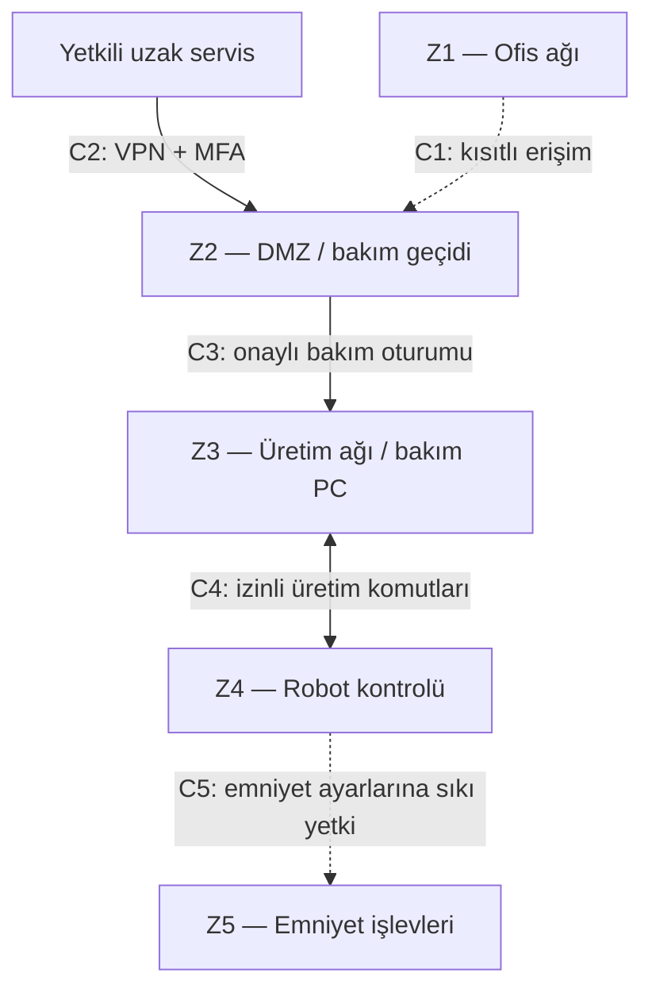

# 05 — Zone & Conduit (Güvenlik Bölgeleri ve Geçişler)

**Makine:** FANUC CRX-10iA  
**Senaryo:** Konveyörden kutu alıp palete yerleştiren varsayımsal robot hücresi.  
**Kapsam:** Kör analiz; gerçek tesisin doğrulanmış ağ yapısı değildir.

## Amaç

**Zone**, benzer korunma ihtiyacına sahip sistemlerin bulunduğu bölgedir. **Conduit** ise iki bölge arasındaki kontrollü geçiştir. `02-Network-Architecture` dosyasında bağlantıları gösterdim; burada **kim, hangi bölgeye, hangi amaçla erişebilir?** sorusuna odaklanıyorum.

## 1. Güvenlik bölgeleri

| Bölge | İçerik | Koruma ihtiyacı |
|---|---|---|
| **Z1 — Ofis ağı** | ERP, e-posta, ofis bilgisayarları | Üretim kontrolünden ayrılmalı. |
| **Z2 — DMZ / bakım geçidi** | VPN sonlandırma, jump server / erişim geçidi (A11) | Dış bağlantılar burada denetlenmeli. |
| **Z3 — Üretim ağı** | Hat HMI'si (A08), üretim PLC'si (A07), bakım PC'si (A10) | Günlük üretim ve bakım erişimi sınırlandırılmalı. |
| **Z4 — Robot kontrolü** | FANUC kontrolörü (A02), programlama paneli (A03), robot (A01) | Hareket programına erişim daha sıkı korunmalı. |
| **Z5 — Emniyet işlevleri** | Acil durdurma, koruyucu duruş ve ilgili kontrol işlevleri (A09) | Normal üretim yetkilerinden bağımsız korunmalı. |

**Z5 için önemli not:** Bu, *mantıksal emniyet sınırıdır*; ayrı bir Ethernet ağı veya harici Safety PLC bulunduğunu iddia etmiyorum. Emniyet işlevleri kontrolör içinde de yer alabilir.

## 2. Bölge / geçiş şeması

**Düz çizgiler** varsayımsal iletişim yollarını, **kesikli çizgiler** kontrollü / mantıksal sınırları temsil eder. **C5 sıradan bir IP ağ bağlantısı değildir.** Acil durdurma sinyali de normal ağ trafiği olarak düşünülmemelidir.

## 3. Conduit kuralları

| Geçiş | İzin verilen amaç | Önerilen kontrol |
|---|---|---|
| **C1: Z1 → Z2** | Yalnız onaylı kurumsal erişim | Firewall, gerekli servislerle sınırlama |
| **C2: Dış servis → Z2** | İhtiyaç halinde uzak bakım | VPN, MFA, süreli erişim |
| **C3: Z2 → Z3** | Yetkili bakım bilgisayarına ulaşım | Jump server, kişisel hesap, oturum kaydı |
| **C4: Z3 ↔ Z4** | PLC–robotun hazır/başlat/tamamlandı iletişimi; onaylı bakım | Yalnız gerekli komutlar ve izinli cihazlar |
| **C5: Z4 ↔ Z5** | Gerekli emniyet yapılandırması / doğrulaması | Ayrı yetki, değişiklik onayı ve kayıt; normal HMI'dan serbest değişiklik yok |

**Temel ilke:** Belirtilmeyen erişimler varsayılan olarak kapalı olmalı. Ofis ağından veya internetten robot kontrolörüne doğrudan bağlantı verilmemeli.

## 4. Risklerle ilişkisi ve sonuç

- **R-02 (04. bölüm):** Dış bakım hesabı kötüye kullanılırsa C2–C3–C4 zincirinde erişim sınırları saldırıyı zorlaştırabilir.
- **R-01:** Hat HMI'sinin robot üzerindeki yetkisi C4'te sınırlandırılmalı.
- **R-03:** Bakım bilgisayarından robot programı yükleme yalnız izin ve kontrolle yapılmalı.

Bu bölgeler **önerdiğim koruma modelidir**; gerçek IP adresleri, portlar, protokoller ve kurulu güvenlik cihazları bilinmiyor. Ayrıntılı uzak bakım prosedürü `06-Remote-Access-Procedure`, emniyet fonksiyonları `03-Safety-Functions` bölümünde ele alınacaktır.

**Ders dayanağı:** `Sunum.pdf` LAB 2; `2.1. lab_foyleri_genel.pdf` sayfa 3; önceki `LAB2-Zone-Conduit.md` çalışması.
