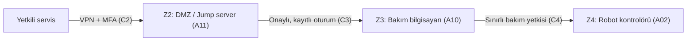

# 06 — Remote Access Procedure (Uzaktan Erişim Prosedürü)

**Makine:** FANUC CRX-10iA  
**Senaryo:** Konveyörden kutuları alıp palete yerleştiren varsayımsal robot hücresi.  
**Kapsam:** Kör analiz; gerçek FANUC kurulumunun erişim prosedürü değildir.

## Amaç

Yetkili bakım personeli gerektiğinde robot kontrolörüne ulaşabilsin; ancak **doğrudan, sürekli açık veya denetimsiz erişim** olmasın. Robotun normal üretim için internete bağlanması gerekmez. Bu prosedür, `02-Network-Architecture` ve `05-Zone-Conduit` bölümlerindeki **önerilen** bakım yolunu açıklar.

## 1. Önerilen erişim yolu

**VPN:** Şifreli bağlantı kurar. **MFA:** Parolaya ek ikinci kimlik doğrulamasıdır. **DMZ / jump server:** Bakım erişiminin denetlendiği ara noktadır. Bu cihaz ve bağlantılar varsayımsal fabrika tasarımımıza aittir.

## 2. Bakım işleminin adımları

| Aşama | Uygulanacak kural | Neden? |
|---|---|---|
| **1. Talep** | Bakım personeli yapılacak işi ve erişim süresini bildirir. | Gereksiz bağlantı açılmaz. |
| **2. Onay** | Sorumlu kişi işi, hedef cihazı ve gereken yetkiyi onaylar. | Herkes robot ayarlarını değiştiremez. |
| **3. Bağlantı** | Kişisel hesap + VPN + MFA ile DMZ üzerinden giriş yapılır. | Doğrudan erişim ve ortak hesap önlenir. |
| **4. İşlem** | Yalnız onaylı cihaz ve işlemlere erişilir; oturum kaydedilir. | Yetkisiz değişiklikler sınırlandırılır. |
| **5. Kontrol** | Değişiklik varsa yerel sorumlu kişiyle işlev ve emniyet kontrolleri yapılır. | Beklenmedik robot hareketi riski azaltılır. |
| **6. Kapatma** | Oturum sonlandırılır, geçici erişim kapatılır ve yapılan işler kaydedilir. | Açık erişim yolu bırakılmaz. |

## 3. Altı erişim kararı

| Konu | Tercih | Gerekçe |
|---|---|---|
| Aracı | **Jump server** | Robot kontrolörüne doğrudan bağlanmamak |
| Tünel | **VPN** | Bağlantıyı şifrelemek |
| Kimlik | **MFA** | Sadece parolayla girişe güvenmemek |
| Hesap | **Kişisel** | İşlemi yapan kişiyi belirlemek |
| Kayıt | **Oturum kaydı** | Yapılan değişiklikleri inceleyebilmek |
| Zamanlama | **Varsayılan kapalı** | Yalnız onaylı bakım süresince erişim açmak |

## 4. Emniyet şartı ve risk bağlantısı

Uzaktan bakım erişimi, **SF-01 acil durdurma, SF-02 koruyucu duruş ve SF-03 güvenli yeniden başlatma** işlevlerini devre dışı bırakamamalıdır. VPN veya bakım bilgisayarı ele geçirilse bile insanı koruyan işlevler gerekli korumayı sürdürmelidir. Robot programı ya da emniyet ayarı değiştirildiyse, uygun yerel doğrulama yapılmadan normal üretime dönülmemelidir.

Bu prosedür, `04-Cyber-Risk-Assessment` içindeki **R-02 (bakım hesabının kötüye kullanılması)** riskine karşı önerilen önlemlerden biridir. Önlemler **tasarlanmıştır; uygulanmış veya test edilmiş değildir.** Gerçek hesaplar, bağlantı kayıtları ve erişim ayarları bilinmiyor.

**Ders dayanağı:** `Sunum.pdf` LAB 4; `2.1. lab_foyleri_genel.pdf` LAB 2 (altı karar) ve LAB 4 (erişim güvenliği + emniyet bağımsızlığı).
