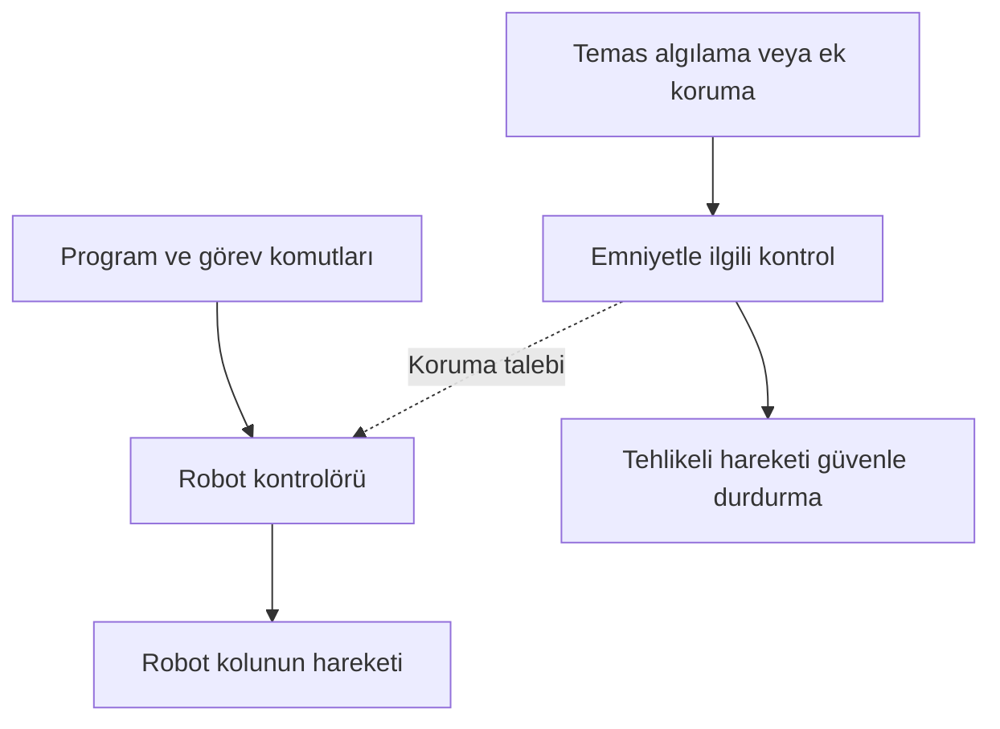

# LAB 1 - Emniyet Mimarisi (Safety Architecture)

**Ders:** YMH459 - Yazılım Mühendisliğinde Güncel Konular  
**Makine:** FANUC CRX-10iA işbirlikçi robot  
**Çıktı:** Safety Function Map (Emniyet Fonksiyon Haritası)

## Bu çalışmada neyi inceliyorum?

CRX-10iA, FANUC'un 6 eksenli ve 10 kg taşıma kapasiteli işbirlikçi robotudur. Erişim mesafesi 1.249 mm'dir. Üretici, dokunmatik programlama ve temas algılama özelliklerini belirtmektedir.

Analizi daha anlaşılır yapmak için robotun bir paketleme hattında kutuları alıp palete yerleştirdiğini **varsayıyorum**. Kutuları tutan aparat, konveyör ve harici sensörler bu örneğin parçası; robotun standart donanımı olduklarını bilmiyoruz.

> **Kör analiz notu:** Robotun genel özellikleri kamuya açık ürün bilgilerinden alınmıştır. Fabrika yerleşimi, ağ bağlantıları ve emniyet kontrolünün iç yapısı bilinmediği için bunlarla ilgili açıklamalarım örnek senaryoya aittir. Gerçek bir FANUC güvenlik açığı bulduğumu iddia etmiyorum.

## Föydeki 8 soruya cevaplarım

**1. Makinedeki tehlikeler neler?**  
Robot kolunun çalışana çarpması, kol ile başka bir yüzey arasında sıkışma ve taşınan kutunun düşmesi tehlike oluşturabilir. Risk, robotun hızına, yüke ve çalışma alanına göre değişir.

**2. Emniyet fonksiyonu (safety function) nedir?**  
Temel amaç, çalışan tehlikeye girdiğinde zararlı robot hareketini güvenli biçimde durdurmaktır. FANUC'un belirttiği temas algılama özelliği bu açıdan önemlidir. Kuruluma göre ilave koruma veya acil durdurma düzeni de gerekebilir.

**3. Emniyetle ilgili kontrol sistemi nerede?**  
Robotun hareketini kendi kontrolörü yönetir. Ancak emniyet işlevlerinin içeride tam olarak hangi parçalarla yürütüldüğünü veya harici bir Safety PLC kullanılıp kullanılmadığını bilmiyorum. Bu yüzden aşağıdaki çizim gerçek bağlantı şeması değil, çalışma mantığının özetidir.

**4. Normal PLC ile Safety PLC'nin farkı nedir?**  
Normal kontrol sistemi üretimi yönetir: robot nereye gidecek, hangi işi yapacak? Emniyet kontrolü ise tehlike halinde insanı korumaya odaklanır. Bunların mutlaka iki ayrı fiziksel PLC olduğu sonucu çıkarılamaz.

**5. PLr ve SIL neden gerekli?**  
Bir emniyet fonksiyonunun ne kadar güvenilir olması gerektiğini belirlemek için kullanılır. Yaralanmanın ağırlığı, tehlikeye maruz kalma sıklığı ve kaçınma olasılığı değerlendirilir. Yalnızca robotun modelini bilerek bu uygulamanın PLr/SIL değerini hesaplayamam.

**6. Güvenli durum (safe state) nedir?**  
Örnek hattımızda robotun tehlikeli hareketini durdurması ve koşullar güvenli olmadan tekrar başlamamasıdır. Ancak robot bir kutu taşıyorsa yükün düşmemesi de hesaba katılmalıdır.

**7. Hangi dijital bağımlılıklar olabilir?**  
Robotun kontrol yazılımı, programları, ayarları ve kullanıcı yetkileri önemlidir. Harici hat kontrolü veya uzaktan bakım bağlantısı varsa bunlar da incelenmelidir. Gerçek kurulumdaki bağlantıların ayrıntısını bilmiyorum.

**8. Siber müdahale nerede emniyeti etkileyebilir?**  
Bir kişinin yeterli yetki olmadan hareket programını veya emniyetle ilişkili ayarları değiştirebildiği **varsayılırsa**, beklenmeyen hareket sonucu çarpma ya da sıkışma yaşanabilir. Bu bir olasılık senaryosudur; CRX-10iA'da tespit edilmiş bir açık değildir.

## Kısa emniyet haritası

| Olası tehlike | Korunması gereken durum |
|---|---|
| Robot kolunun çarpması | Tehlikeli hareketin güvenli durdurulması |
| Robot ile yüzey arasında sıkışma | İnsan tehlike altındayken hareketin önlenmesi |
| Tutucudan yük düşmesi | Yükün güvenli tutulması / bırakılması |
| Beklenmeyen yeniden başlama | Güvenli koşullar sağlanmadan hareketin başlamaması |

## Sonuç

Bu robotu incelerken yalnızca üretim hareketlerine değil, **insanla aynı alanda çalıştığında neyin onu güvenli tuttuğuna** da bakmam gerekiyor. Bir sonraki LAB'da kontrol sistemleri ve olası bağlantıları ağ bölgelerine ayıracağım.

## Kaynaklar

- [FANUC CRX-10iA resmî ürün sayfası](https://www.fanuc.eu/tr-tr/urun/robot/crx-10ia)
- Ders materyali: *2.1. lab_foyleri_genel.pdf*, sayfa 2 (LAB 1).
- Ders materyali: *Sunum.pdf*, LAB 1 bölümü.
