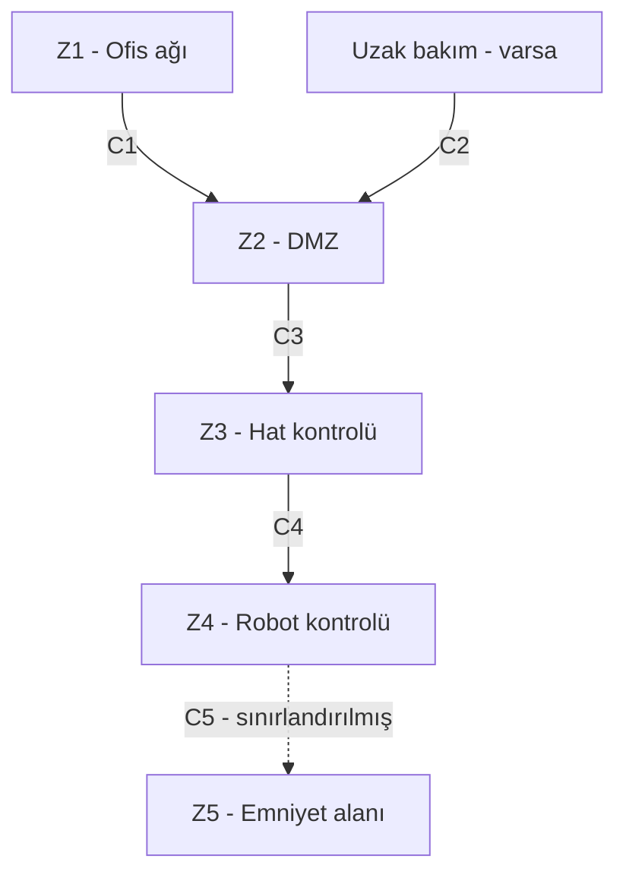

# LAB 2 - Ağ Bölgeleri ve Bağlantılar (Zone / Conduit)

**Ders:** YMH459 - Yazılım Mühendisliğinde Güncel Konular  
**Makine:** FANUC CRX-10iA işbirlikçi robot  
**Çıktı:** Zone / Conduit Diagram

## Amaç

Bu çalışmada robotla ilgili cihazları ve olası bağlantıları gruplandırıyorum. Ders föyündeki iki temel kavram:

- **Zone (bölge):** Benzer korunma ihtiyacı olan cihazların bulunduğu alan.
- **Conduit (geçiş):** Bölgeler arasındaki kontrollü bağlantı.

Örneğimiz, LAB 1'deki **kutu taşıyan robotun bulunduğu paketleme hattıdır**. Aşağıdaki fabrika ağı benim kurduğum örnek mimaridir; FANUC'un gerçek ağ planı değildir.

## 1. Önce neleri saydım? (Varlık envanteri)

Dersteki altı kategoriye göre başlangıç listem:

| Kategori | İncelediğim varlıklar |
|---|---|
| Donanım | Robot kolu, robot kontrolörü ve programlama arayüzü; örnek senaryoda konveyör ve HMI |
| Yazılım | Robotun görev programı ve kontrol yazılımı; örnek hat yazılımı |
| Hesaplar | Operatör ve bakım personeli hesapları (roller örnek olarak düşünülmüştür) |
| Anahtarlar | Uzaktan bağlantı kurulacaksa VPN veya benzeri giriş bilgileri |
| Dış bağlantılar | Varsa fabrika ağı ve kontrollü uzaktan bakım erişimi |
| Veri akışı | Hareket programı, üretim komutu, robot durumu ve hata kayıtları |

Robot ve programlama arayüzü üretici bilgisinde yer alıyor. Harici HMI, konveyör, VPN ve bakım ağı ise **varsayımsal**. Hangi portların açık olduğu, yazılım sürümü ve gerçekten uzaktan bağlantı kullanılıp kullanılmadığı bilinmiyor.

## 2. Görev A - Bölgelere ayırma

### Soru 1: Hangi varlıklar aynı bölgede?

| Bölge | İçerik (örnek kurulum) | Neden ayırdım? |
|---|---|---|
| **Z1 - Ofis ağı** | ERP, e-posta, ofis bilgisayarları | Robot kontrolüne doğrudan ulaşmamalı |
| **Z2 - DMZ** | Kontrollü bakım geçidi / jump server | Dışarıdan gelen erişimi denetlemek için |
| **Z3 - Hat kontrolü** | Konveyör kontrolü, hat HMI'si | Günlük üretim işlemleri burada |
| **Z4 - Robot kontrolü** | FANUC kontrolörü, robot programı | Hareket komutları daha sıkı korunmalı |
| **Z5 - Emniyet alanı** | Emniyetle ilişkili kontrol işlevleri | Koruma, normal üretim değişikliklerinden etkilenmemeli |

### Soru 2: Safety PLC hangi bölgede olmalı?

Ayrı bir Safety PLC **kullanılıyorsa** Z5'te olmasını öneriyorum. Çünkü çalışanı koruyan işlevler normal üretim ağıyla aynı yetkilere açık olmamalı. **CRX-10iA'nın mutlaka harici Safety PLC kullandığını bilmiyoruz.** Bu nedenle Z5, burada bir *koruma sınırını* da temsil ediyor.

### Soru 3: Bölgeler arasındaki geçişler nerede?

| Geçiş | Bağlantı | Kontrol önerim |
|---|---|---|
| **C1** | Z1 → Z2 | Güvenlik duvarı ve izin verilen servisler |
| **C2** | Dış bakım → Z2 | VPN, MFA ve süreli izin |
| **C3** | Z2 → Z3 | Jump server ve oturum kaydı |
| **C4** | Z3 → Z4 | Yalnız gerekli komutlar, yetki kontrolü |
| **C5** | Z4 → Z5 | Emniyet ayarlarına erişimin sıkı kısıtlanması |

**Not:** Oklar örnek/önerilen bağlantılardır. Robotun gerçekten internete açık olduğu anlamına gelmez.

## 3. Görev B - Uzaktan erişim için 6 karar

Uzak bakımın gerekli olduğunu **varsayarak** şu seçimleri yaptım:

| Föydeki soru | Seçimim | Neden? |
|---|---|---|
| Doğrudan mı, aracı mı? | **Jump server** | Robot ağına direkt giriş olmasın |
| Açık mı, tünel mi? | **VPN** | Dış bağlantı şifreli olsun |
| Parola mı, MFA mı? | **MFA** | Yalnız parola yeterli olmasın |
| Paylaşılan mı, kişisel mi? | **Kişisel hesap** | İşlemi yapan kişi belli olsun |
| Kayıt yok mu, tam kayıt mı? | **Tam oturum kaydı** | Yapılan değişiklikler incelenebilsin |
| Sürekli mi, ihtiyaç halinde mi? | **Varsayılan kapalı** | Kullanılmayan bağlantı açık kalmasın |

## Sonuç

Robotla ilgili her bağlantının aynı güven seviyesinde olmaması gerektiğini gördüm. Özellikle bakım erişimi ve emniyetle ilişkili kontrolleri daha dikkatli ayırmak gerekiyor. LAB 3'te bu olası giriş noktalarından başlayarak risk senaryoları oluşturacağım.

## Kaynaklar

- Ders materyali: *2.1. lab_foyleri_genel.pdf*, sayfa 3 (LAB 2).
- Ders materyali: *Sunum.pdf*, LAB 2 bölümü.
- [FANUC CRX-10iA resmî ürün sayfası](https://www.fanuc.eu/tr-tr/urun/robot/crx-10ia)
- Önceki çalışma: `LAB1-Safety-Architecture.md`.
