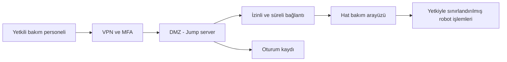

# LAB 4 — Güvenli Uzaktan Erişim

**Ders:** YMH459 — Yazılım Mühendisliğinde Güncel Konular  
**İncelenen makine:** FANUC CRX-10iA işbirlikçi robot  
**Çalışma:** Kör analiz / varsayımsal paketleme hattı  
**Çıktı:** Secure Architecture (Güvenli Mimari)  
**Durum:** İlk taslak

> Bu çalışma, dersin LAB 4 föyünü seçtiğim robota uyarlamak için hazırlanmıştır. FANUC'un gerçek bir fabrikadaki ağ yapısını bilmiyorum. Uzaktan bakım bağlantısı ve burada anlatılan zayıf başlangıç düzeni **varsayımdır**; FANUC ürününde açık bulunduğu anlamına gelmez.

## 1. Ne yapmaya çalışıyorum?

LAB 1'de robotun çalışanlara çarpma ve sıkışma gibi fiziksel tehlikelerini, LAB 2'de örnek ağ bölgelerini, LAB 3'te ise üç olası tehdit senaryosunu inceledim.

Bu bölümde LAB 3'teki **R-02 (uzaktan bakım hesabının kötüye kullanılması)** senaryosuna odaklanıyorum. Örnek çalışmada risk puanı **L=2, S=3, E=2 → 12 (Yüksek)** çıkmıştı. Ama bu puan gerçek bir FANUC kurulumunun ölçülmüş riski değil, eğitim senaryosunun puanıdır.

İki ayrı soruyu cevaplamak istiyorum:

1. Bir bakım personeli makineye **nasıl daha kontrollü bağlanmalı**?
2. Birisi bağlantıyı ele geçirse bile **insanı koruyan emniyet işlevi nasıl etkilenmemeli**?

## 2. Görev A — Mevcut ve hedef erişim düzeni

### Mevcut durum (varsayımsal, zayıf örnek)

Örnek paketleme hattında dışarıdan bakım yapılabildiğini varsayıyorum. Bakım hesabı birkaç kişi tarafından paylaşılıyor, erişim yeterince sınırlandırılmıyor ve oturum kayıtları tutulmuyor. Böyle bir ortamda hesaba izinsiz ulaşan biri, kendisine gereğinden fazla yetki verilmişse robotun hareket programıyla ilişkili değişikliklere erişebilir.

**Örnek akış:**

`Bakım kullanıcısı → Zayıf/paylaşılan hesap → Hat yönetim sistemi → Robot kontrolü`

**Eksikler:** Kişiye özel hesap yok; güçlü ikinci doğrulama yok; erişim süresi ve hedefi yeterince kısıtlanmamış; kimin ne değiştirdiği izlenemiyor.

**Not:** Bunlar CRX-10iA'nın fabrika ayarları olarak ileri sürülmüyor. Yalnızca dersin verdiği karşılaştırma için oluşturulmuş başlangıç örneğidir.

### Hedef durum (öneri)

Bakım zorunlu olduğunda erişimi aşağıdaki gibi düzenlerdim:

**Şema açıklaması:** Bu, örnek bir hedef mimaridir. FANUC'un gerçek ağ topolojisi, uzaktan erişim ürünü veya bağlantı protokolü olarak yorumlanmamalıdır.

### Hedef mimarinin beş temel ilkesi

| İlke | Bu çalışmada önerdiğim uygulama | Neden? |
|---|---|---|
| **1. Ara nokta** | Doğrudan robot ağına bağlanmak yerine **jump server** kullanılması | Bakım erişimini tek noktadan sınırlandırmak ve denetlemek |
| **2. Kişisel hesap** | Her bakım personelinin ayrı hesabı olması | Hangi işlemi kimin yaptığını takip edebilmek |
| **3. MFA** | Parolaya ek ikinci kimlik doğrulama | Çalınan tek bir parolanın yeterli olmasını önlemek |
| **4. Varsayılan kapalı** | Bakım bağlantısını yalnızca onaylı süre boyunca açmak | Sürekli açık erişim yolunu azaltmak |
| **5. Oturum kaydı** | Giriş, yapılan değişiklikler ve çıkışın kaydedilmesi | Hata veya olay sonrasında inceleme yapabilmek |

**Ek karar:** Ağ trafiği için VPN, güvenlik duvarında yalnızca gerekli hedeflere izin ve bakım yetkilerinin sınırlanmasını öneriyorum. Bu kararlar LAB 2'de seçtiğim altı uzaktan erişim tercihiyle uyumludur.

## 3. Görev B — Functional Safety (işlevsel emniyet) bağlantısı

### Soru 1 — Saldırgan bütün erişim önlemlerini aşarsa emniyet fonksiyonu etkilenir mi? Neden?

**Cevabım:** Bunun cevabı gerçek uygulamadaki emniyet mimarisine bağlıdır. Yalnızca VPN ve MFA olması, robotun fiziksel olarak güvenli kalacağını garanti etmez. Bir saldırgan bakım arayüzünü ele geçirse bile tehlikeli hareketi önleyen koruma işlevlerinin yetkisiz değişikliklerden etkilenmemesi gerekir.

Örnek paletleme hattında koruma yetersiz olursa robot beklenmedik hareket edebilir ve çalışan robot ile sabit bir yüzey arasında sıkışabilir. Ancak **CRX-10iA'nın böyle bir güvenlik açığı olduğunu bilmiyorum ve iddia etmiyorum**. Gerçek durumu anlamak için üreticinin kamuya açık emniyet belgeleri ve uygulamanın risk değerlendirmesi incelenmelidir.

### Soru 2 — Emniyet işlevinin normal kontrol sisteminden bağımsızlığı için gereksinim nedir?

**Gereksinim:** *Robotun insanı tehlikeli hareketten koruyan emniyet fonksiyonları, normal üretim veya uzaktan bakım kontrol sistemi ele geçirilse ya da hatalı çalışsa bile gerekli korumayı sürdürebilmeli; emniyetle ilgili değişiklikler yalnızca yetkili, kontrollü ve doğrulanabilir süreçlerle yapılabilmelidir.*

Bu ifade **gereksinimdir**, doğrudan belirli bir cihaz veya devre çözümü değildir. Ayrı bir Safety PLC kullanılmasının zorunlu olduğunu da varsaymıyorum. Gerçek tasarım ve doğrulama, robotun ve kurulu hücrenin emniyet belgelerine göre yapılmalıdır.

## 4. LAB 3'teki R-02 riski nasıl değişebilir?

Bu bölüm yalnızca önerilen önlemlerin uygulanıp **test edilmesi durumunda** yapılabilecek örnek bir yeniden puanlamadır.

| Durum | L | S | E | Skor | Not |
|---|---:|---:|---:|---:|---|
| Varsayımsal zayıf başlangıç | 2 | 3 | 2 | **12 — Yüksek** | Paylaşılan / zayıf bakım hesabı |
| Erişim kontrolleri uygulanırsa (örnek hedef) | 1 | 3 | 2 | **6 — Orta** | MFA, kişisel hesap, ara nokta ve kayıt ile istismar zorlaşabilir |

**S=3 bayrağı iki durumda da korunur.** Erişimin zorlaşması, olası ağır yaralanmanın ciddiyetini tek başına azaltmaz. Emniyet bağımsızlığının gerçekten sağlandığı doğrulanmadığı için **S değerini düşürmedim**. Mevcut gerçek kurulum bilinmediğinden bu rakamlar sahada ölçülmüş artık risk değildir.

## 5. Hangi kanıtları görmek isterdim?

Bir işletmede bu düzenin gerçekten kullanıldığını doğrulamak için şunları incelerdim:

- Uzaktan bakımın ne zaman açıldığını gösteren erişim prosedürü.
- Kullanıcı ve yetki listesi; kişisel hesapların tanımlanması.
- MFA ve VPN ayarlarının uygulanmasına ilişkin kayıtlar.
- Jump server ve bakım oturumu kayıtları.
- Robot programı veya emniyet ayarı değişikliklerine ilişkin onay ve test kayıtları.
- Emniyet fonksiyonlarının bakım veya ağ arızası durumunda da koruma sağladığını gösteren doğrulama sonuçları.

Şu an elimde gerçek bir kurulumun bu kayıtları bulunmadığı için kanıt durumu **taslak / doğrulanmadı** olarak kalıyor.

## 6. Kısa sonuç

LAB 4'te vardığım sonuç şu: **Siber erişimi korumak ve fiziksel emniyeti korumak iki farklı iş.** VPN, MFA, kişisel hesap ve kayıt gibi önlemler uzaktan bağlantıyı güvenli hâle getirmeye yardım eder. Fakat bunlardan biri başarısız olduğunda bile insanı koruyan emniyet işlevleri ayrıca korunmalıdır. FANUC CRX-10iA için böyle bir değerlendirmeyi gerçek kurulum kanıtı olmadan kesin sonuç gibi sunamam.

Bu çalışma, LAB 1–3'te kullandığım varsayımsal paketleme hattıyla tutarlıdır ve **LAB 4 — Secure Architecture** çıktısı için başlangıç metnidir.

## Kaynaklar

1. Dersin *2.1. lab_foyleri_genel.pdf* belgesi, **LAB 4 — Secure Remote Access**, sayfa 5: mevcut/hedef mimari ile işlevsel emniyetin bağımsızlığına yönelik iki soru.
2. Dersin *Sunum.pdf* belgesi, **LAB 4 — Secure Remote Access Challenge**: ara nokta, kişisel hesap, MFA, varsayılan kapalı, oturum kaydı ve emniyet bağımsızlığı.
3. *5. Kavramlar_Sozlugu.docx*: VPN, MFA, jump server ve emniyet bağımsızlığı tanımları.
4. Bu depodaki *LAB2-Zone-Conduit.md* ve *LAB3-Threat-Risk-Analysis.md*: önerilen ağ bölgeleri ve R-02 senaryosu.
5. [FANUC CRX-10iA — resmî ürün sayfası](https://www.fanuc.eu/tr-tr/urun/robot/crx-10ia): makinenin kamuya açık genel özellikleri; buradaki varsayımsal ağ senaryosunun kanıtı değildir.

---

*Ders kapsamında hazırlanmış ön çalışma. Resmî denetim veya ürün güvenlik uyarısı değildir.*
