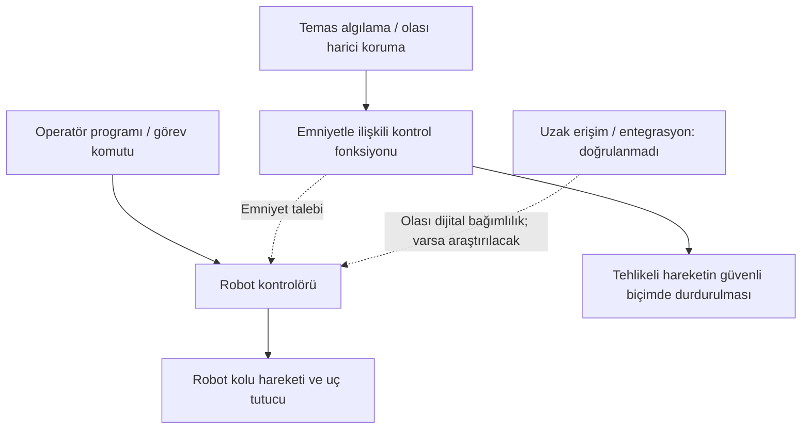

# LAB 1 — Safety Architecture (Emniyet Mimarisi)

**Ders:** YMH459 – Yazılım Mühendisliğinde Güncel Konular  
**Öğrenci:** Furkan Baran Akşitkütay  
**Öğrenci No:** 265542009  
**Makine:** FANUC CRX-10iA İşbirlikçi Endüstriyel Robot (Cobot)  
**Çıktı:** Safety Function Map (Emniyet Fonksiyon Haritası)  
**Tarih:** 23 Ekim 2026  
**Çalışma türü:** Kamuya açık bilgilerle kör analiz – ilk laboratuvar taslağı

> **Önemli kapsam notu:** Bu çalışma, dersin *2.1. lab_foyleri_genel.pdf* dosyasındaki LAB 1 soruları **FANUC CRX-10iA'ya uyarlanarak** hazırlanmıştır. Belirli bir fabrikadaki gerçek robot kurulumu incelenmemiştir. Makineye ait doğrulanmamış ağ bağlantıları, emniyet modülleri veya güvenlik zafiyetleri gerçekmiş gibi gösterilmez. Bu bir resmî risk değerlendirmesi, CE uygunluk beyanı ya da güvenlik sertifikasyonu değildir.

## Kullanılan işaretler

- **[D] Doğrulanmış:** Kamuya açık üretici dokümanıyla doğrulanabilir bilgi.
- **[V] Varsayım:** Dersin yöntemini uygulamak amacıyla oluşturulmuş olası üretim/entegrasyon senaryosu.
- **[B] Bilinmiyor:** Kamuya açık kaynaklardan bu kurulum için doğrulanamayan teknik ayrıntı.

## 1. Makinenin tanıtımı ve çalışma senaryosu

**[D]** CRX-10iA; 6 eksenli, en fazla 10 kg yük taşıyabilen ve 1.249 mm erişime sahip işbirlikçi endüstriyel robot modelidir. Üretici; dokunmatik programlama arayüzü ve hassas temas algılama özelliğini belirtir. Model için üreticinin sayfasında R-30iB Plus kontrolör ailesi listelenmiştir.

**[V] Eğitim senaryosu:** Robotun, paketleme hattında uygun bir uç tutucuyla kutuları taşıyıp palete yerleştirdiğini varsayıyoruz. Konveyör, kutu algılama sensörü ve kavrayıcı yalnızca örnek *entegrasyon bileşenleridir*; robotun standart donanımı olduklarını iddia etmiyoruz.

### Varsayımsal proses akışı

1. Paket konveyörle taşıma konumuna gelir.
2. Sistemde bir algılama düzeneği varsa paket algılanır.
3. Robot önceden programlanmış hareketi gerçekleştirir.
4. Varsayımsal tutucu paketi palete bırakır.
5. Emniyet koşulları sağlandığında döngü sürer.

## 2. LAB 1 sorularına cevaplar

### Soru 1 — Bu makinede tehlike nedir? İnsan neyden zarar görür?

**[V]** Tehlike adayları: (a) robot kolu ile sabit yüzey arasında **sıkışma/ezilme**, (b) robot kolu veya tutucunun operatöre **çarpması**, (c) tutucudan düşen yükün **çarpması/yaralaması**. Risk düzeyi; yük kütlesine, harekete, hıza, uç tutucuya, çalışma alanına ve operatörün konumuna göre değişir. Cobot olması, tüm görevlerin ilave risk değerlendirmesi olmadan güvenli olduğu anlamına gelmez.

### Soru 2 — Safety function (emniyet fonksiyonu) hangisidir?

**[D]** FANUC, CRX serisinde hassas temas algılama özelliği bulunduğunu ve robotun insanla hafif temas durumunda güvenli biçimde durabildiğini belirtmektedir. Bu, değerlendirmemiz için önemli bir emniyet özelliğidir.

**[V]** Örnek paket taşıma hücresindeki temel emniyet hedefi, operatörün tehlikeye maruz kalacağı durumda **tehlikeli robot hareketini emniyetli şekilde durdurmak** ve uygun koşullar oluşmadan yeniden başlamamasını sağlamaktır. Acil durdurma ve gerekiyorsa koruyucu alan algılama gibi tedbirlerin uygulama özelinde nasıl sağlandığı ayrıca belirlenmelidir.

### Soru 3 — Safety-related control system nerede? Şemada işaretleyin.

**[D]** Robotun hareketlerini FANUC kontrolör ailesi yönetir. Temas algılama, üreticinin belirttiği emniyetle ilgili bir özelliktir.

**[B]** Yalnızca kamuya açık ürün tanıtımına dayanarak, incelenen modelin belirli kurulumunda **ayrı bir Safety PLC bulunduğunu**, bu PLC'nin marka/modelini veya iç bağlantı şemasını söyleyemeyiz. Dersteki genel şema, FANUC'un birebir elektrik şeması değildir.

**Kavramsal Safety Function Map (gerçek bağlantı şeması değil):**

**Şema okuma:** Üst hat normal üretim kontrolünü, alt hat emniyet amacını temsil eder. Gerçek emniyet işlevlerinin hangi bileşenlere dağıtıldığı üreticinin uygun teknik emniyet belgeleri ve uygulama tasarımıyla doğrulanmalıdır. Emniyetin normal hareket yazılımından hangi düzeyde bağımsız olduğu ayrıca sorgulanır.

### Soru 4 — Normal PLC ile Safety PLC farkı nedir?

- **Normal PLC/kontrol mantığı:** Üretim adımlarını, hareket sırasını ve proses komutlarını yürütür; amacı istenen görevi gerçekleştirmektir.
- **Safety PLC/emniyet kontrol mantığı:** İnsan emniyetine ilişkin koruyucu işlevleri, gerekli güvenilirlikle yürütmek için tasarlanır ve doğrulanır; tehlikeli durumda koruyucu tepkiyi sağlar.

**[B]** Bu kavramsal fark, CRX-10iA hücresinde mutlaka fiziksel olarak iki ayrı PLC bulunduğu anlamına gelmez. Robotik kontrolörlerde güvenlikle ilişkili işlevler farklı mimarilerle sağlanabilir.

### Soru 5 — PLr / SIL neden var? Bu fonksiyon için neden önemlidir?

**PLr (Performance Level required – gerekli performans seviyesi)** ve **SIL (Safety Integrity Level – emniyet bütünlük seviyesi)**, emniyet işlevleri için gereken güvenilirliği risk düzeyine göre tanımlamak için kullanılır. Ağır yaralanma potansiyeli, maruz kalma sıklığı ve tehlikeden kaçınma olanağı gibi unsurlar değerlendirilir.

**[B]** Robotun yalnızca model adına bakılarak varsayımsal paketleme hücresinin *gerekli* PLr/SIL seviyesi belirlenemez. Belirli uygulama için ayrıca tehlike analizi ve risk değerlendirmesi gerekir. Ürün bileşeni için ilan edilen bir performans seviyesi de tüm hücrenin otomatik olarak aynı seviyede olduğu anlamına gelmez.

### Soru 6 — Safe state (güvenli durum) nedir?

**[V]** Bu senaryoda güvenli durum, robotun insanı tehlikeye sokacak hareketi **kontrollü/emniyetli biçimde durdurması** ve güvenli koşullar oluşmadan hareketin yeniden başlamamasıdır. Ancak tutucunun tuttuğu yükün düşmesi yeni bir tehlike yaratabileceğinden “bütün gücü kesmek” her kurulumda tek başına yeterli değildir. Yükün güvenli tutulması/bırakılması uygulama tasarımıyla değerlendirilmelidir.

### Soru 7 — Safety function hangi dijital bağımlılıklara sahip?

**[V]** İncelenmesi gereken muhtemel bağımlılıklar: robot kontrolörü yazılımı, hareket ve emniyetle ilgili parametrelerin yönetimi, kullanıcı/yetki rolleri, program değişiklikleri, varsa harici robot hücresi kontrol sistemi ve varsa bakım bağlantıları.

**[B]** Bu kurulumda hangi arayüzlerin **gerçekte mevcut olduğu**, hangilerinin emniyet işlevini değiştirmeye izin verdiği, firmware sürümü ve uzaktan erişim topolojisi bilinmemektedir. Kanıt bulunmadan VPN, açık port, varsayılan parola veya ayrı Safety PLC varmış gibi envantere yazılmaz.

### Soru 8 — Siber müdahale hangi noktadan emniyet fonksiyonunu bozar?

**[V] Koşullu tehdit örneği:** Bir entegrasyonda yetkisiz bir kullanıcı **hareket veya emniyetle ilişkili ayarları değiştirme yetkisi** kazanabiliyorsa, değişen hareket davranışı ya da koruma koşulları robotun çalışma alanındaki bir kişiyi tehlikeye sokabilir. Olası zincir: **yetkisiz erişim → yetkisiz parametre/program değişikliği → beklenmedik tehlikeli hareket → çarpma/sıkışma yaralanması**.

**[B]** Bunun FANUC CRX-10iA üzerinde keşfedilmiş bir açık olduğu söylenemez. Gerçek bağlantılar, erişim izinleri ve emniyet bağımsızlığı bilinmeden gerçekleşme olasılığına puan verilmez. Nihai tehdit senaryoları, LAB 2 envanterine dayanarak LAB 3'te yazılacaktır.

## 3. Safety Function Map — kısa özet tablosu

| Tehlike | İstenen emniyet fonksiyonu | Tetikleyici / girdi | Beklenen güvenli tepki | Kanıt durumu |
|---|---|---|---|---|
| Robotla insanın çarpışması | Zararlı hareketin sınırlanması/durdurulması | Üretici tarafından belirtilen temas algılama; uygulamaya göre ek koruma | Tehlikeli hareketi güvenli biçimde durdurma | Temas algılama [D]; hücre tasarımı [B] |
| Robot ile sabit yüzey arasında sıkışma | Tehlikeli bölgeye girildiğinde koruma | Olası harici alan koruması / uygulama risk analizi | Tehlikeli hareketin engellenmesi | [V] |
| Paketin düşmesi | Yükün insana zarar vermesini önleme | Uç tutucunun durumu / yük kontrolü | Uygulamaya uygun yük güvenliği | [V] |
| Güvensiz yeniden başlatma | Koruma koşulları sağlanmadan yeniden çalışmayı engelleme | Yeniden başlatma koşulları | Kontrollü tekrar başlatma | [V] |

## 4. Kamuya açık bilgiyle doğrulanamayanlar

1. Seçilen makinenin gerçek bir fabrikadaki ağ topolojisi, IP/port bilgileri ve uzak bakım düzeni.
2. Emniyet kontrol bileşenlerinin kesin mimarisi ve harici emniyet ekipmanının modeli.
3. Kullanıcı rollerinin ve servis hesaplarının gerçek yapılandırması.
4. Robotun belirli bir kurulumdaki firmware/yazılım sürümü.
5. Uç tutucu, paketleme hücresi ve ek koruyucu donanımın fiilî tasarımı.

Bu bilgi boşlukları gizlenmeyecek; laboratuvar çalışmasının **bulgusu** olarak saklanacaktır.

## 5. Değerlendirme ve sonraki adım

LAB 1 sonucunda önemli tehlikeler ve korunması gereken işlevler belirlendi. Bir sonraki aşama olan **LAB 2 – Zone / Conduit**, robot kontrolörü, operatör arayüzü ve **yalnızca kanıtlanmış veya açıkça varsayımsal etiketli** diğer sistemleri varlık envanterine alarak bölgeler ve erişim yollarını inceleyecektir. LAB 3 risk puanlaması, bu envanter tamamlandıktan sonra yapılacaktır.

## Kaynaklar

**Üretici – açık erişim**

1. FANUC Türkiye, *CRX-10iA ürün sayfası*: https://www.fanuc.eu/tr-tr/urun/robot/crx-10ia  
   (6 eksen, 10 kg taşıma, 1.249 mm erişim, kontrolör, arayüz ve temas algılama)
2. FANUC America, *CRX-10iA model bilgileri*: https://crx.fanucamerica.com/crx-10ia  
   (teknik bilgiler ve işbirlikçi uygulama tanıtımı)

**Ders materyalleri – kamuya yeniden dağıtılmadan başvurulan kaynaklar**

3. *2.1. lab_foyleri_genel.pdf*, sayfa 2, LAB 1 – Safety Architecture (sekiz soru ve örnek normal/emniyet kontrol akışı).
4. *Sunum.pdf*, LAB 1 – Safety Architecture bölümü (emniyet/güvenlik ayrımı, safety yolu, PLr/SIL mantığı).
5. *5. Kavramlar_Sozlugu.docx*, Emniyet & Makine (LAB 1) başlığı.

---

*Revizyon: 0.1 — akademik ön analiz. Varsayımlar, üreticinin gerçek kurulumuna ilişkin iddia değildir.*
