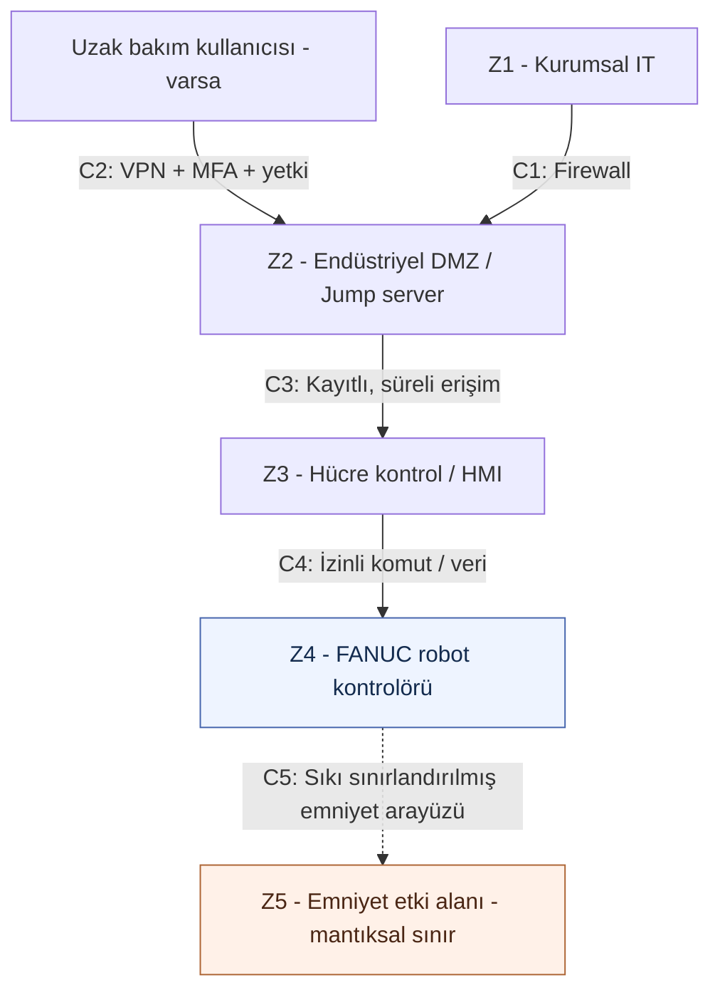

# LAB 2 — IEC 62443 Mini Workshop: Zone / Conduit Analizi

**Ders:** YMH459 — Yazılım Mühendisliğinde Güncel Konular  
**Makine:** FANUC CRX-10iA İşbirlikçi Endüstriyel Robot (Cobot)  
**Çıktı:** Zone / Conduit Diagram (Bölge ve Kontrollü Bağlantı Diyagramı)  
**Tarih:** 23 Ekim 2026  
**Durum:** Sürüm 0.1 — kör analiz / eğitim senaryosu

> **Kapsam:** Bu çalışma, *2.1. lab_foyleri_genel.pdf* içindeki LAB 2 görevlerinin FANUC CRX-10iA modeline uyarlanmasıdır. Üreticiye ya da bir fabrika işletmecisine ulaşılarak alınmış bilgi içermez. Gerçek bir FANUC kurulumunun ağ planı, güvenlik açığı analizi veya IEC 62443 sertifikasyonu değildir. Çizilen mimari **önerilen/varsayımsal bir fabrika entegrasyonudur**; ürünün fabrika çıkışı iç mimarisi olarak yorumlanmamalıdır.

## 1. Amaç ve temel kavramlar

- **Zone (bölge):** Benzer güvenlik kritikliğine ve koruma gereksinimlerine sahip cihazların mantıksal olarak gruplandırıldığı alan.
- **Conduit (kontrollü geçiş):** İki bölge arasındaki veri iletişiminin kurallarla yönetildiği bağlantı. Kimin, neye, hangi yönde ve ne zaman erişeceği tanımlanır.
- **DMZ (ara bölge):** Kurumsal ağ veya dış dünya ile üretim ağı arasında denetimli hizmetlerin konumlandırıldığı tampon bölge.
- **Safety (emniyet):** Tehlikeli fiziksel hareketlerden insanı korumaya ilişkin fonksiyonlar. **Security (siber güvenlik):** Yetkisiz erişim ve kasıtlı dijital müdahaleye karşı koruma.

Bu ayrım ve altı varlık kategorisi, dersin *Sunum.pdf* (LAB 2) ve *5. Kavramlar_Sozlugu.docx* belgelerinden alınmıştır.

### Kanıt işaretleri

- **[D] Doğrulanmış bilgi:** Üreticinin kamuya açık model bilgileri ile destekleniyor.
- **[V] Varsayımsal entegrasyon:** LAB 2'nin yöntemini uygulamak için tasarlanmış örnek paketleme/paletleme hücresi.
- **[B] Bilinmiyor:** Modelin belirli bir kurulumu için henüz doğrulanamayan bilgi.

## 2. Görev öncesi: altı kategoride varlık ve saldırı yüzeyi envanteri

Ders sunumundaki altı envanter kategorisini makinemize uyguluyoruz. **Varsayımsal varlıklar bir güvenlik açığı bulunduğu anlamına gelmez.**

| Kategori | Varlık / olası giriş noktası | İşlevi / neden dikkate alınır? | Kanıt durumu |
|---|---|---|---|
| 1. Donanım | FANUC CRX-10iA robot kolu ve robot kontrolörü | Hareketi yürütür; kontrolöre erişim önemlidir | **[D]** Robot ve kontrolör ailesi üretici bilgisinde yer alır |
| 1. Donanım | Dokunmatik programlama arayüzü | Operatörün hareket/görev programlaması | **[D]** Üreticinin tanıttığı kullanım özelliği |
| 1. Donanım | Konveyör, ürün algılama sensörü, tutucu | Örnek paletleme hattının ekipmanları | **[V]** Entegrasyon bileşenleri |
| 1. Donanım | Harici HMI, mühendislik istasyonu, ağ anahtarı | Örnek fabrika hücresindeki yönetim araçları | **[V]** Bu ürünün standart paketinde olduğu iddia edilmiyor |
| 1. Donanım | Harici Safety PLC / alan tarayıcı | Uygulama riskine bağlı ek koruma | **[B]/[V]** Gerçek kurulumda bulunup bulunmadığı bilinmiyor |
| 2. Yazılım / firmware | Robot kontrolör yazılımı ve görev programları | Hareket komutları ve konfigürasyon | **[D]** Yazılımın varlığı; **[B]** kurulu sürüm/ayrıntı |
| 2. Yazılım / firmware | Harici HMI/hat yönetim yazılımı | Varsayımsal hat koordinasyonu | **[V]** |
| 3. Hesaplar | Operatör, bakım personeli ve mühendis rolleri | Yetkisiz yapılandırma değişiklikleri engellenmeli | **[V]** Örnek rol modeli; gerçek kullanıcı listesi **[B]** |
| 4. Sertifika / anahtar | VPN, servis kimlik bilgisi veya erişim anahtarı | Uzaktan bakım **kurulursa** erişimi doğrular | **[V]** Bu kurulumda olup olmadığı **[B]** |
| 5. Dış bağlantı | Servis sağlayıcıdan kontrollü uzaktan bakım | Eğitim senaryosunda olası dış bağlantı | **[V]** İnternete açık FANUC bağlantısı iddiası değildir |
| 5. Dış bağlantı | ERP/MES — fabrika üretim ağı bağlantısı | Üretim emri/durum bilgisinin olası aktarımı | **[V]** |
| 6. Kritik veri akışı | Görev programı, iş emri, robot durum bilgisi, alarm kaydı | Bütünlüğü ve yetki sınırları korunması gereken veriler | **[V]** Gerçek protokol ve akışlar **[B]** |

### Kamuya açık kaynaklardan hâlâ bilinmeyenler

Bu robotun incelenen belirli bir fabrikadaki IP adresleri, açık portları, ağ segmentleri, VPN düzeni, servis hesapları, kullanılan firmware sürümleri ve harici emniyet kontrol mimarisi elimizde **yoktur**. Bu alanlara `bilinmiyor / doğrulama gerekir` yazmak, olmayan bir açıklığı uydurmaktan daha doğrudur.

## 3. Görev A — Varlıkları bölgelere ayırın

### Soru 1 — Hangi varlıklar aynı bölgede? Bölgeleri adlandırın

Aşağıdaki zone düzeni, **seçilmiş bir mimari önerisidir [V]**:

| Bölge | Varsayımsal bileşenler | Gerekçe |
|---|---|---|
| **Z1 — Kurumsal IT** | Ofis ağı, ERP/e-posta istemcileri | Üretimle farklı güven seviyesi; doğrudan robot yönetimi yetkisi verilmemeli |
| **Z2 — Endüstriyel DMZ** | Jump server, erişim kayıtları, bakım erişim geçidi | Kurumsal/dış erişim ile OT sistemleri arasında denetimli ara katman |
| **Z3 — Üretim OT / Hücre Kontrol** | Hat HMI'si, varsa konveyör PLC'si, hücre izleme istasyonu | Normal üretim ve operatör komutlarını yürütür |
| **Z4 — Robot Kontrol** | FANUC robot kontrolörü, robot programlarına erişen yetkili arayüz | Hareket programlarının değiştirilmesi ciddi fiziksel sonuçlar doğurabilir |
| **Z5 — Emniyet Etki Alanı (mantıksal koruma)** | Emniyetle ilişkili işlevler; varsa harici koruyucu sistem | Yetkisiz üretim/bakım erişiminden en yüksek düzeyde ayrılması hedeflenir |

**Önemli:** Z5 mantıksal olarak ayrı bir **koruma alanı** olarak çizildi. Gerçek robot içinde veya hücresinde **ayrı bir Safety PLC bulunduğu** anlamına gelmez. Aynı kontrolör üzerindeki emniyet işlevlerinin bağımsızlığı da üretici güvenlik belgeleriyle ayrıca değerlendirilmelidir.

### Soru 2 — Safety PLC'yi hangi bölgeye koydunuz, neden?

**Cevap:** Harici Safety PLC **kullanılması gereken bir uygulama olduğunu varsayarsak**, bu bileşeni **Z5 — Emniyet Etki Alanı** içinde tutarız. Çünkü tehlikeli robot hareketini durdurma gibi işlevlerin sıradan üretim komutlarından ve dış bakım yollarından korunması gerekir. Üretim ağına ihtiyaç duyulan iletişimler özel olarak sınırlandırılmalıdır.

Bununla birlikte **CRX-10iA kurulumunda ayrı bir Safety PLC bulunduğunu doğrulamış değiliz**. Gerçekte emniyet işlevinin hangi onaylı kontrol bileşenleri üzerinden sağlandığı, kurulum projesi ve üretici dokümanıyla belirlenir. Z5 fiziksel cihaz sayısı değil, **emniyet sınırı** olarak değerlendirilmiştir.

### Soru 3 — Bölgeler arası geçişler (conduit) nerede? Ne kontrol edilecek?

| Geçiş | Bağlanan bölgeler | Gerekli kontrol / ilke | Durum |
|---|---|---|---|
| **C1** | Z1 Kurumsal IT → Z2 DMZ | Firewall izin listesi; yalnız gerekli servisler; erişim kayıtları | **[V]** |
| **C2** | Dış bakım kullanıcısı → Z2 DMZ | VPN, MFA, kişisel hesap, onaylı zaman aralığı | **[V]** Dış erişim varlığı **[B]** |
| **C3** | Z2 DMZ → Z3 OT | Jump server; hedef bazlı ve süreli yetkilendirme; oturum kaydı | **[V]** |
| **C4** | Z3 Hücre Kontrol → Z4 Robot Kontrol | Yalnız gereken komut/veri; yetki ayrımı; değişiklik kaydı | **[V]** Protokol/portlar **[B]** |
| **C5** | Z4 Robot Kontrol ↔ Z5 Emniyet Etki Alanı | Yalnız emniyet tasarımının izin verdiği arayüzler; yetkisiz parametre değişikliğinin engellenmesi | **[V]** Gerçek fiziksel/lojik arayüz **[B]** |

**Kural:** Dış bakım bağlantısının, doğrulanmış emniyet işlevlerini devre dışı bırakabilecek doğrudan kontrol yetkisine sahip olması hedef mimaride kabul edilmez.

### Zone / Conduit Diagram — GitHub üzerinde görüntülenebilir çizim

**Şema notu:** Diyagramdaki yollar, modelin internete bağlı olduğunun ya da belirli portları dinlediğinin **kanıtı değildir**. Bu, kör analiz için geliştirdiğimiz **önerilen güvenlik sınırları** şemasıdır.

## 4. Görev B — Uzaktan erişim kararı (altı satır)

Ders föyündeki iki seçenekli altı soruyu, **dışarıdan bakım erişimi kurulması gerektiği varsayımıyla** cevaplıyoruz:

| Karar | Seçim | Neden? |
|---|---|---|
| **Aracı?** | **Jump server** | Bakım personelinin doğrudan robot ağına ulaşmasını engeller; denetimli ara nokta sağlar. |
| **Tünel?** | **VPN** | Dışarıdan gelen iletişimin şifreli ve kurallı bir tünel üzerinden yürütülmesini sağlar. |
| **Kimlik?** | **MFA** | Tek başına ele geçirilen parolanın yetkisiz erişim için yeterli olmasını zorlaştırır. |
| **Hesap?** | **Kişisel** | Kimin hangi değişikliği yaptığını izlemek ve erişimi gerektiğinde kaldırmak kolaylaşır. |
| **Kayıt?** | **Tam oturum kaydı** | Bakım sırasında yapılan işlemler sonradan incelenebilir; olay analizi için kanıt sağlar. |
| **Zamanlama?** | **Varsayılan kapalı** | Bakım erişimi yalnız onaylı ihtiyaç halinde, sınırlı süreyle açılır; sürekli açık kapı bırakılmaz. |

**Sonuç:** Dış erişim zorunluysa kontrollü, kişiye özel, kayıtlı ve süreli tutulmalıdır. **Uzak erişim bulunmadığı bir kurulumda bu geçiş hiç açılmamalıdır.** Bu altı seçim FANUC'un mevcut ayarlarını anlatmaz; önerilen güvenlik kararlarıdır.

## 5. LAB 1'le bağlantı: Emniyet neden ayrı ele alındı?

LAB 1'de insanın robotla **çarpışması**, robot ile sabit yüzey arasında **sıkışması** ve tutucudan düşen yükün zarar vermesi olasılıklarını değerlendirmiştik. Siber bir erişim sorunu, ancak belirli koşullarda bu **fiziksel tehlikelerden birine yol açabiliyorsa** Safety 4.0 bakımından özel önem taşır.

**[V] Koşullu senaryo:** Varsayımsal bakım yolu üzerinden hareket/koruma ile ilişkili bir ayar yetkisiz değiştirilirse robot beklenmedik hareket edebilir ve operatörün çalışma alanında yaralanma meydana gelebilir.

**[B] Kritik belirsizlik:** Böyle bir değişikliğin gerçek CRX-10iA kurulumunda hangi arayüzlerden yapılabildiğini bilmiyoruz; bunun ürünün mevcut bir açığı olduğu iddia edilemez.

## 6. LAB 2 çıktısı ve sonraki adım

Bu taslakla aşağıdakiler üretilmiştir:

1. Altı kategoride **ön varlık/saldırı yüzeyi envanteri**.
2. Beş güvenlik bölgesinden oluşan **önerilen Zone / Conduit Diagram**.
3. Beş kritik bağlantı için **erişim kontrol ilkeleri**.
4. Uzaktan bakımda **altı seçenek ve gerekçesi**.
5. **Doğrulanmamış bilgiler listesi** — var olmayan zafiyetler uydurulmamıştır.

**LAB 3'e hazırlık:** Dersin LAB 3 yönergesi, en az **3 saldırgan profili ve 3 tehdit senaryosu** ile L × S × E risk puanlaması istiyor. Senaryolardaki giriş noktaları bu LAB 2 envanterine dayandırılacak; varsayımsal bağlantılar açıkça varsayımsal tutulacak. Gerçek bir sisteme ilişkin kesin risk skoru için kurulum verisi gerekir.

## Kaynaklar

**Ders materyalleri (yeniden yayımlanmadan kullanıldı)**

1. *2.1. lab_foyleri_genel.pdf*, sayfa 3: **LAB 2 — IEC 62443 Mini Workshop**; varlıkları bölgelere ayırma, Safety PLC kararı, bağlantılar ve uzaktan erişimin altı seçimi.
2. *Sunum.pdf*, LAB 2 — IEC 62443 bölümü: Zone / Conduit tanımları ve altı envanter kategorisi.
3. *5. Kavramlar_Sozlugu.docx*, **Ağ & IEC 62443 (LAB 2)**: PLC, HMI, SCADA, DMZ, firewall ve conduit tanımları.
4. *LAB1-Safety-Architecture.md*, bu GitHub projesinde daha önce hazırlanmış çalışma: tehlikeler ve koruma hedefleri.

**Kamuya açık üretici kaynakları**

5. [FANUC CRX-10iA — üretici ürün sayfası](https://www.fanuc.eu/tr-tr/urun/robot/crx-10ia) — robot tipi, teknik nitelikler, kontrolör ve programlama arayüzü.

---

*Bu belgede geçen mimari, makineye ait teyit edilmiş bir fabrika ağının kopyası değil, ders amaçlı bir kör analiz modelidir. Sürüm 0.1.*
